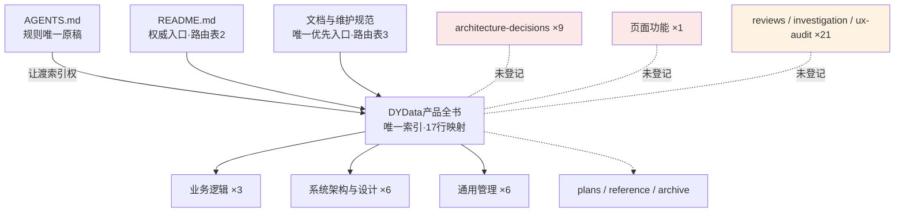
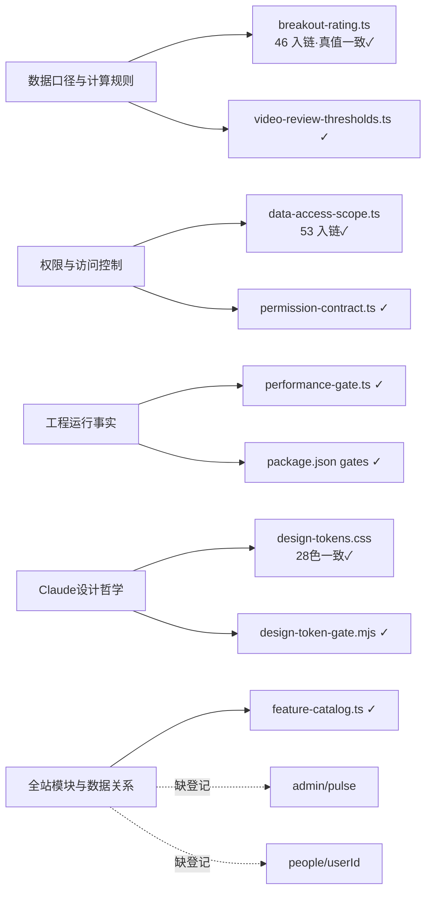
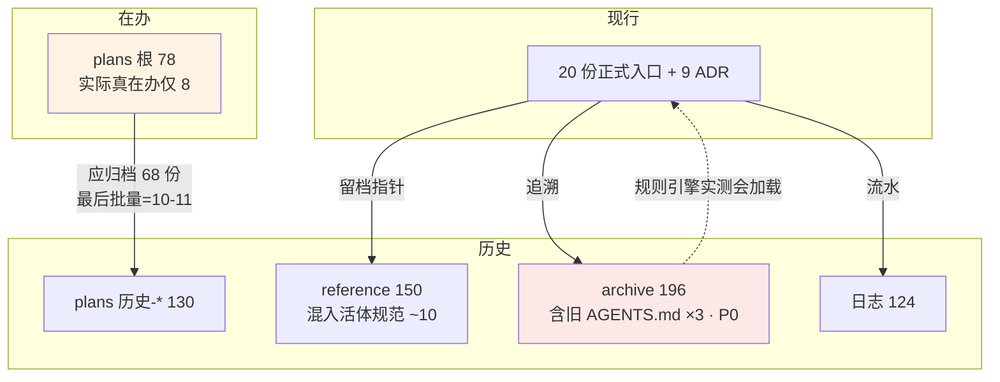

# 02 · 文档引用关系与关联图

> 方法：对 788 份文档（787 跟踪+1 未跟踪）全量提取 Markdown 链接与正文路径引用，共 **3863 条出边**、**2420 条失效引用**。失效按来源分区解读：archive 1013 / plans 749 / 日志 456 / reference 152 属历史区自然悬空（历史文档引用当时存在、后被搬迁/删除的路径，不判违规）；**活跃区失效 159 条**才是治理对象，其中经逐条人工复核剔除工具误报（正则截断 `CLAUDE.md写作指南.md`、`(app)` 括号路径、`YYYY/xxx` 占位符）后，**真实断链约 40 条**，列于 §二。

## 一、枢纽与入度（有效引用计数）

| 文档 | 入度 | 角色 |
|---|---:|---|
| docs/通用管理/待办清单.md | 38 | 事实上的任务枢纽（plans/reference 大量回写它） |
| docs/系统架构与设计/工程运行事实.md | 32 | 工程事实枢纽，引用质量最高（出边全有效） |
| docs/系统架构与设计/权限与访问控制.md | 30 | 权限权威 |
| docs/系统架构与设计/数据口径与计算规则.md | 24 | 口径权威 |
| docs/系统架构与设计/全站模块与数据关系.md / Claude设计哲学.md | 各 21 | 架构/设计枢纽 |
| src/lib/data-access-scope.ts | 53 | 被文档引用最多的代码文件 |
| src/lib/breakout-rating.ts | 46 | 评级真值源 |

**孤立（0 入链）的正式文档**：CLAUDE.md、README.md（入口性质，正常）；**ADR 0001-0005 与运行底座 5/9 条 0 入链**；`docs/页面功能/` 仅被 1 份归档件+1 条日志引用；`日志/` 3 份特例文件 0 入链。

## 二、活跃区真实断链清单（复核后）

### A. 现行入口/权威文档中的断链（P1）

| 来源 | 行 | 目标 | 实况 |
|---|---|---|---|
| docs/通用管理/待办清单.md | :19 | `docs/plans/数据口径说明页与一致性修复.md` | 已归档为 `plans/历史-方案/2026-10-15-同名文件`，路径+文件名双错 |
| docs/通用管理/纠错索引.md | :172 | `scripts/audit/audit-screenshot-orphans.mjs` | 不存在（find 全 scripts 无匹配） |
| docs/通用管理/纠错索引.md | :48 | "AGENTS.md 第四节" | 禁令实在 §三（:114） |
| docs/通用管理/待办清单.md | :88 | "AGENTS.md §四 部署节" | 部署实在 §三（同上误引） |
| docs/系统架构与设计/数据口径与计算规则.md | :212 | `src/lib/growth-page.ts` | growth 页 09-26 已下线删除 |
| docs/系统架构与设计/组件与场景契约.md | :182 | `components/app-shell/app-shell.tsx` | 目录为空，组件不存在 |
| docs/系统架构与设计/核心业务流程与异常边界.md | :88 | `/api/topics/library-status` | 实际路由 `src/app/api/admin/content/topic-library-status/` |
| docs/通用管理/CLAUDE.md写作指南.md | :57-58 | `docs/系统架构与设计/…`（相对链接） | 从 通用管理/ 出发解析成 `docs/通用管理/docs/…`，写法需改 `../` |
| docs/reference/2026-10-08-阶段2…受控回滚.sql 等 | — | （本身为违规入库物） | 见 04 |

### B. ADR 证据链整批断链（P1，最严重的一类）

| 来源 | 目标 | 实况 |
|---|---|---|
| 0001:6 / 0002:6 / 0003:6(×2) / 0004:6 / 0005:6 / 0006:21 | `docs/plans/2026-10-02-*` 系列 | 全部已移入 `docs/archive/2026-11-09-A批文档治理/计划原稿/历史-项目/根治工程/`，6/8 条 ADR 证据悬空 |
| 0006:21 | 待办清单"门禁判据与脚本不一致"行 | 待办清单中查无此条（双重失效） |

### C. 在办 plans 中的代码断链（P2，随归档自然消解）

`2026-10-12-豁免审批台修复计划`（15 处 `src/components/command-hub/*.ts` 应为 `.tsx`——正则误报与真错混杂，其中 dialog/confirm-dialog 等实际存在为 .tsx）；`2026-10-10-移交Codex` 指向已删脚本 `scripts/diagnose-deepseek.ts` 等（待办清单 :69 已自登记）；`2026-10-13-数据上传架构根治方案` 引用的 `src/lib/video-submit/report-date.ts` **不存在**（方案落地时改名或未建，需归档时核对）。

### D. 已自登记的断链（实测全部属实）

待办清单 :69 登记的 10 处预存断链：`scripts/diagnose-deepseek.ts`、`scripts/cleanup-ds-direct.ts`、`docs/plans/数据口径说明页与一致性修复.md`、`docs/reference/awesome-claude-design/LICENSE` 等——主审逐条复核，**与本次扫描结果一致，无新增遗漏口径**。

## 三、入口结构问题

1. **三张路由表并存**：产品全书 §一（17 行映射）、文档与维护规范 §一"唯一优先入口"（7 行）、README"文档导航（权威入口）"（§38-42），外加 AGENTS.md :101-110 目录表与散链。内容目前指向同一批文件（未实质打架），但**任一路由变更需同步 3-4 处**，漂移已实测发生（见 04 冲突#4）。
2. **未登记入口的正式区**：`docs/architecture-decisions/`、`docs/页面功能/`、`docs/archive/2026-11-09-A批文档治理/参考原稿/reviews/`（仅规范提了一句）、`docs/archive/2026-11-09-A批文档治理/参考原稿/investigation/`、`docs/ux-audit/` 均不在产品全书映射表——违反全书纪律 5"新增共用文件时同步更新本表"。
3. **多重管理**：`docs/plans/上下文交接/`（实例目录）同时被全书 :21、plans/README :17、AGENTS.md 提及——路由自洽✓；但 `2026-10-05-P2性能治理第一笔盘点.md` 在 plans 根与 `历史-项目/根治工程/` **各存一份完全相同副本**（diff 实测 SAME），违反 plans/README :44"归档是移动不是复制"。
4. **反向悬空**：已提交日志/plans 正文引用 `output/`（gitignored）路径，换机或清理后证据链断裂。

## 四、关系图

### 4.1 现行入口路由（三表并存）

### 4.2 权威文档 → 代码真值源（对账结果见 03）

### 4.3 正式文档 ↔ 历史区

## 五、循环与依赖观察

- 无恶性循环引用；`工程运行事实 ↔ 后端工程规范`（互相引用但分工清楚）；`待办清单 ↔ plans` 双向维护是设计使然，但待办 :19/:21 的滞后说明**缺"plan 移动→回写待办"的触发器**。
- 引用密度健康：正式区 20 份合计出边 ~140，绝大多数有效——**现行核心层维护质量高，问题集中在 ADR、页面功能、归档区边界与 plans 积压**。
